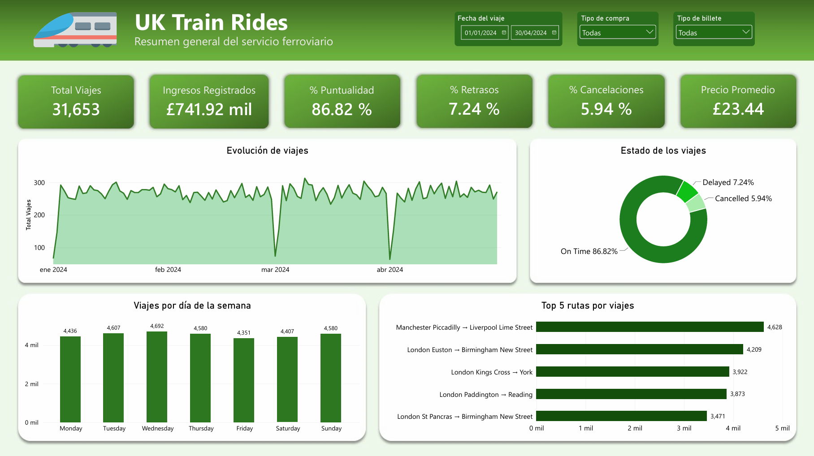
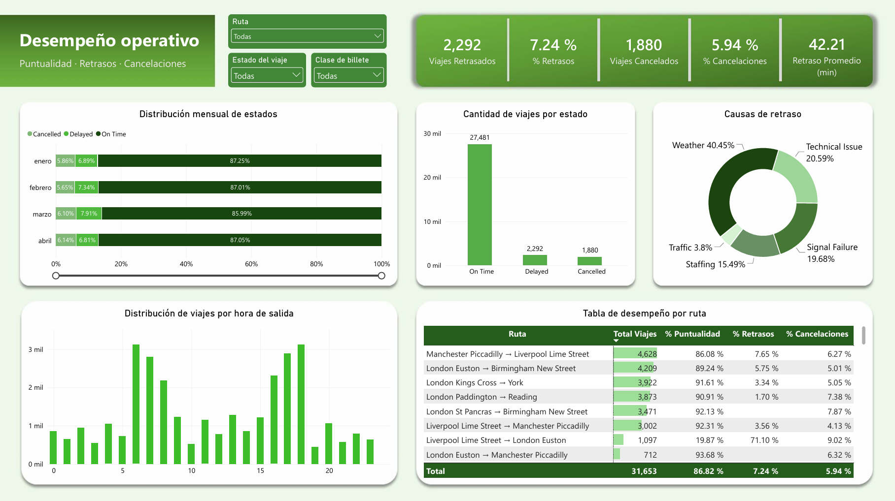
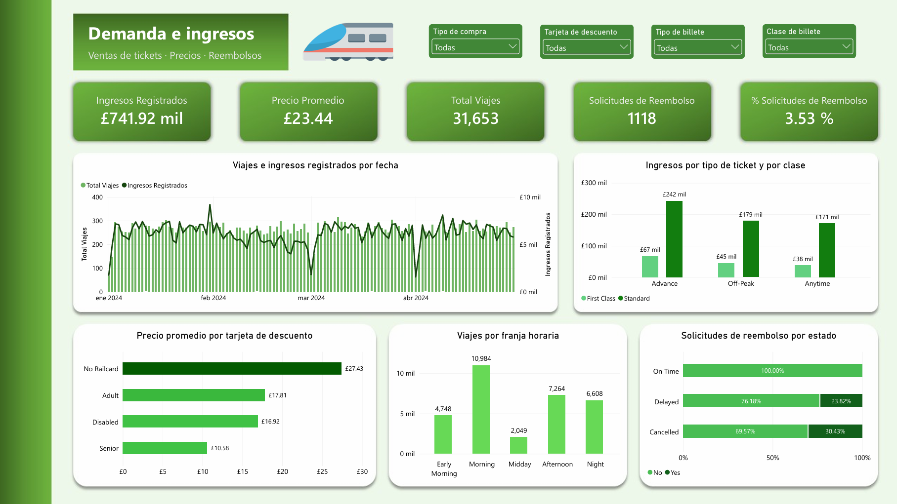

# 🚆 UK Train Rides - Análisis de Demanda y Desempeño Operativo

**Análisis de datos con Python, PostgreSQL y Power BI para identificar patrones de demanda, ingresos registrados y oportunidades de mejora en el servicio ferroviario del Reino Unido.**

---

## 📌 Descripción del proyecto

Este proyecto tiene como finalidad analizar el comportamiento de los viajes ferroviarios del Reino Unido, evaluando la demanda, los ingresos registrados por la venta de tickets y el desempeño operativo del servicio.

Mediante herramientas de análisis de datos, se transformaron los registros originales en información útil para identificar rutas con mayor demanda, patrones de ingresos, causas de retrasos y oportunidades de mejora en la experiencia del pasajero.

### 🎯 Objetivo

Analizar el comportamiento de los viajes y las ventas, identificando las rutas y horarios de mayor demanda, las diferencias de ingresos según el tipo de ticket y clase, y los principales factores asociados a retrasos y cancelaciones.

### 🧩 Problema de negocio

La empresa ferroviaria necesita comprender cómo se comporta la demanda de sus servicios y qué factores están relacionados con el desempeño de los viajes, con el fin de identificar oportunidades para mejorar la planificación operativa y la experiencia del pasajero.

---

## 🛠️ Herramientas utilizadas

| Herramienta | Aplicación en el proyecto |
|---|---|
| 🐍 **Python** | Limpieza, transformación y validación de datos con pandas. |
| 🐘 **PostgreSQL** | Consultas SQL para analizar la demanda, los ingresos y el desempeño operativo. |
| 📊 **Power BI** | Desarrollo de un dashboard interactivo para visualizar indicadores y resultados. |

---

## ⚙️ Desarrollo del proyecto

### 1. 🐍 Preparación y limpieza de datos - Python

Se realizó la exploración inicial del dataset y se prepararon los datos para el análisis.

- Tratamiento de valores nulos e inconsistencias en las categorías.
- Estandarización de las causas de retraso.
- Creación de variables derivadas, como ruta, día de la semana y franja horaria.
- Cálculo de la duración programada del viaje, los minutos de retraso y la anticipación de compra.
- Validación de la consistencia de los datos y exportación del dataset limpio.

### 2. 🐘 Análisis de datos - PostgreSQL

Se desarrollaron consultas SQL para obtener información sobre:

- Demanda por ruta, día de la semana y hora de salida.
- Ingresos registrados por ruta, clase y tipo de ticket.
- Distribución de viajes puntuales, retrasados y cancelados.
- Principales causas de retraso y rutas con incidencias operativas.
- Solicitudes de reembolso según el estado del viaje.

### 3. 📊 Visualización de datos - Power BI

Se construyó un dashboard interactivo de tres páginas para facilitar la exploración de los resultados:

| Página | Contenido |
|---|---|
| 📍 **Resumen general** | Indicadores principales, evolución de los viajes, distribución por día y rutas con mayor demanda. |
| ⏱️ **Desempeño operativo** | Puntualidad, retrasos, cancelaciones, causas de retraso y desempeño por ruta. |
| 💷 **Demanda e ingresos** | Ingresos registrados, precios de tickets, demanda por franja horaria y solicitudes de reembolso. |

---

## 📈 Principales resultados

### 🚉 Demanda de viajes

| Indicador | Resultado |
|---|---:|
| Total de registros analizados | 31,653 |
| Ruta con mayor cantidad de viajes | Manchester Piccadilly → Liverpool Lime Street |
| Viajes en la ruta de mayor demanda | 4,628 |
| Viajes en la franja de la mañana | 10,984 |
| Participación de la franja de la mañana | 34.7% |

**Hallazgo:** La demanda no se distribuye de manera uniforme entre las rutas y los horarios. Identificar estos patrones permite evaluar oportunidades para mejorar la planificación y la asignación de recursos.

### 💷 Ingresos registrados

| Indicador | Resultado |
|---|---:|
| Ingresos registrados totales | £741,92 |
| Ingresos de la clase Standard | £592,52 |
| Ingresos de la clase First Class | £149,40 |
| Ingresos de tickets Advance | £309,27 |
| Ingresos de tickets Off-Peak | £223,34 |
| Ingresos de tickets Anytime | £209,31 |

**Hallazgo:** La clase Standard concentró la mayor parte de los ingresos registrados. Por tipo de ticket, Advance presentó el mayor importe acumulado.

### ⏱️ Desempeño operativo

| Estado del viaje | Cantidad | Porcentaje |
|---|---:|---:|
| ✅ Puntual | 27,481 | 86.82% |
| ⚠️ Retrasado | 2,292 | 7.24% |
| ❌ Cancelado | 1,880 | 5.94% |
| **Total** | **31,653** | **100%** |

**Principales causas de retraso**

| Causa | Casos | Porcentaje de los retrasos |
|---|---:|---:|
| 🌧️ Clima (Weather) | 927 | 40.45% |
| 🔧 Incidencias técnicas | 472 | 20.59% |
| 🚦 Fallos de señalización | 451 | 19.68% |
| 👥 Personal (Staffing) | 355 | 15.49% |
| 🚆 Tráfico ferroviario | 87 | 3.80% |

**Hallazgo:** Aunque la mayoría de los viajes se registró como puntual, el clima, las incidencias técnicas y los fallos de señalización concentraron aproximadamente el 80.7% de los retrasos.

Además, la ruta Liverpool Lime Street → London Euston registró 780 viajes retrasados, equivalentes al 78.16% de sus viajes puntuales y retrasados evaluados.

### 💳 Solicitudes de reembolso

| Indicador | Resultado |
|---|---:|
| Solicitudes registradas | 1,118 |
| Porcentaje sobre el total de registros | 3.53% |
| Viajes cancelados con solicitud | 30.43% |
| Viajes retrasados con solicitud | 23.82% |

**Hallazgo:** Las solicitudes de reembolso se concentraron en viajes cancelados y retrasados. Estos resultados permiten identificar oportunidades para revisar la atención a los pasajeros afectados.

---

## 💡 Propuestas de mejora

A partir de los hallazgos, se plantean las siguientes oportunidades:

1. **🌧️ Gestión de incidencias climáticas:** fortalecer los protocolos de contingencia y la comunicación con los pasajeros ante condiciones meteorológicas adversas.
2. **🚉 Seguimiento de rutas críticas:** investigar las rutas con mayor cantidad de retrasos, mayor proporción de incidencias o mayores tiempos de demora.
3. **🔧 Mantenimiento preventivo:** profundizar en los registros de incidencias técnicas y fallos de señalización para identificar oportunidades de prevención.
4. **💳 Gestión de reembolsos:** revisar el proceso de atención y la comunicación dirigida a los pasajeros afectados por retrasos y cancelaciones.
5. **📊 Planificación basada en la demanda:** utilizar los patrones por ruta y franja horaria como apoyo para evaluar la asignación de recursos y la capacidad del servicio.

> **Nota:** Estas propuestas requieren análisis adicional antes de determinar su viabilidad e implementación.

---

## 📸 Dashboard de Power BI

### 1. 📍 Resumen general

Vista de los principales indicadores del servicio ferroviario, la evolución de los viajes y las rutas con mayor demanda.



### 2. ⏱️ Desempeño operativo

Análisis de la puntualidad, los retrasos, las cancelaciones y las principales incidencias por ruta.



### 3. 💷 Demanda e ingresos

Visualización de los ingresos registrados, los precios de los tickets, los patrones horarios y las solicitudes de reembolso.



---

## 📝 Conclusiones

El análisis permitió identificar patrones de demanda, diferencias en los ingresos registrados y oportunidades para investigar el desempeño operativo del servicio ferroviario.

Los resultados muestran que, si bien la mayoría de los viajes se registró como puntual, existen rutas con una incidencia relevante de retrasos y causas operativas que merecen un análisis más profundo.

La integración de Python, PostgreSQL y Power BI permitió desarrollar un flujo de trabajo que abarca la preparación de los datos, el análisis mediante consultas SQL y la presentación de resultados mediante indicadores y visualizaciones interactivas.

## ⚠️ Alcance y limitaciones

- **Demanda:** la cantidad de registros se utiliza como aproximación al volumen de viajes; no representa necesariamente pasajeros únicos ni la ocupación de los trenes.
- **Ingresos:** los importes corresponden a la suma de los precios registrados. No representan utilidad ni ingresos netos después de costos o reembolsos.
- **Reembolsos:** una solicitud registrada no implica necesariamente que el reembolso haya sido aprobado o pagado.
- **Interpretación:** los resultados muestran patrones y asociaciones; no demuestran causalidad.
- **Propuestas:** las oportunidades identificadas requieren información adicional para evaluar su viabilidad, impacto y costo.

---

## 📂 Estructura del repositorio

```text
uk-train-rides-analysis/
│
├── 01_Data/
│   ├── railway.csv
│   ├── railway_data_dictionary.csv
│   └── railway_clean.csv
│
├── 02_Python/
│   └── railway_data_cleaning.ipynb
│
├── 03_SQL/
│   └── railway_analysis_queries.sql
│
├── 04_PowerBI/
│   └── uk_train_rides_dashboard.pbix
│
├── 05_Images/
│   ├── 01_resumen_general.png
│   ├── 02_desempeño_operativo.png
│   └── 03_demanda_ingresos.png
│
└── README.md
```

## 📚 Fuente de datos

- **Dataset:** UK Train Rides.
- **Fuente original:** https://mavenanalytics.io/data-playground/uk-train-rides.
- **Licencia de la fuente:** Public Domain.

Se conserva el dataset original y la versión limpia para facilitar la trazabilidad del proceso de preparación de los datos.

## 👨‍💻 Autor

**Juan Pablo Torres**  
Estudiante de Ingeniería Industrial | Data Analyst & BI | Excel · SQL · Power BI · Python | Optimización de Procesos

Proyecto desarrollado como parte de mi portafolio profesional, aplicando herramientas de análisis de datos para transformar información en hallazgos y oportunidades de mejora.

